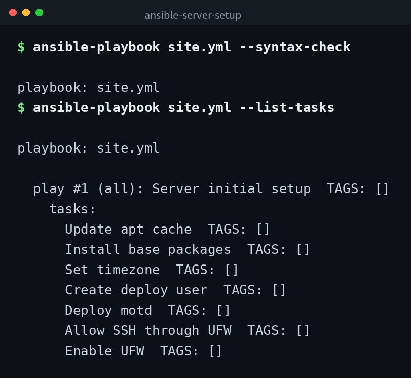

English | [日本語](ja/README.md) | [한국어](ko/README.md)


# ansible-server-setup

An Ansible playbook for automating initial server setup. It handles package installation, timezone configuration, deploy user creation, and UFW firewall setup.

## Demo



## Prerequisites

- Ansible 2.14 or later
- Target servers must be Ubuntu / Debian based
- The `community.general` collection must be installed

```bash
ansible-galaxy collection install community.general
```

## Structure

```
ansible-server-setup/
├── ansible.cfg        # Ansible configuration
├── inventory.ini      # Inventory (connection targets)
├── group_vars/
│   └── all.yml        # Variables shared across all hosts
├── site.yml           # Main playbook
└── templates/
    └── motd.j2        # Login message template
```

## Usage

### 1. Edit the Inventory

Add the IP addresses or hostnames of your target servers to the `[servers]` section in `inventory.ini`.

### 2. Dry Run

Check what would be executed without making actual changes:

```bash
ansible-playbook site.yml --check --diff
```

### 3. Execute

```bash
ansible-playbook site.yml
```

You can specify a different inventory file with `-i`:

```bash
ansible-playbook site.yml -i /path/to/inventory.ini
```

### 4. Local Testing

Use the `[local]` group in `inventory.ini` to test on your local machine:

```bash
ansible-playbook site.yml --limit local
```

## Customizing Variables

Edit `group_vars/all.yml` to change the following variables:

| Variable | Description | Default |
|----------|-------------|---------|
| `timezone` | Server timezone | `Asia/Tokyo` |
| `deploy_user` | Name of the deploy user to create | `deploy` |
| `base_packages` | List of packages to install | vim, curl, git, htop, ufw, unattended-upgrades |

## Notes

- This playbook does not include operations that could disconnect your session, such as SSH configuration changes.
- The default UFW policy is deny. SSH (port 22) is already allowed. If you need other ports, add the corresponding tasks beforehand.
- Always verify with `--check` before applying to production.

## Clone

```bash
git clone https://github.com/mivork/ansible-server-setup.git
```
