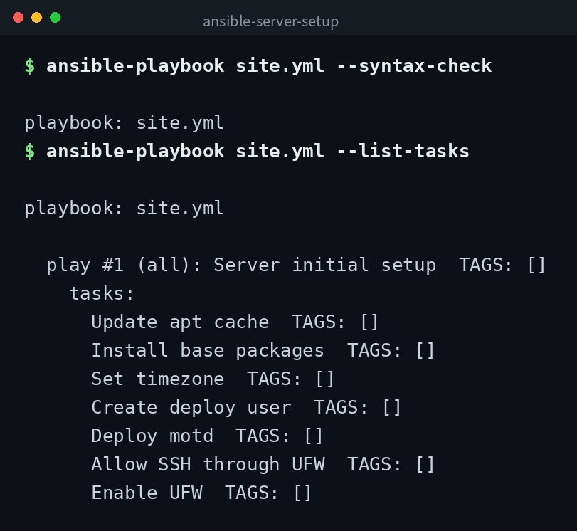

[English](../README.md) | 日本語 | [한국어](../ko/README.md)


# ansible-server-setup

Ansible でサーバーの初期セットアップを自動化するプレイブックです。パッケージのインストール、タイムゾーン設定、デプロイユーザーの作成、UFW によるファイアウォール設定を行います。

## デモ



## 前提

- Ansible 2.14 以上
- 対象サーバーは Ubuntu / Debian 系
- `community.general` コレクションがインストール済みであること

```bash
ansible-galaxy collection install community.general
```

## 構成

```
ansible-server-setup/
├── ansible.cfg        # Ansible の設定
├── inventory.ini      # インベントリ（接続先の定義）
├── group_vars/
│   └── all.yml        # 全ホスト共通の変数
├── site.yml           # メインのプレイブック
└── templates/
    └── motd.j2        # ログイン時メッセージのテンプレート
```

## 使い方

### 1. インベントリの編集

`inventory.ini` の `[servers]` セクションに対象サーバーの IP アドレスまたはホスト名を記載してください。

### 2. ドライラン（確認）

実際には変更を加えず、何が実行されるかを確認します。

```bash
ansible-playbook site.yml --check --diff
```

### 3. 本実行

```bash
ansible-playbook site.yml
```

別のインベントリファイルを使う場合は `-i` で指定できます。

```bash
ansible-playbook site.yml -i /path/to/inventory.ini
```

### 4. ローカルでの動作確認

`inventory.ini` の `[local]` を使えば、ローカルマシンで試すことができます。

```bash
ansible-playbook site.yml --limit local
```

## 変数のカスタマイズ

`group_vars/all.yml` で以下の変数を変更できます。

| 変数 | 説明 | デフォルト値 |
|------|------|-------------|
| `timezone` | サーバーのタイムゾーン | `Asia/Tokyo` |
| `deploy_user` | 作成するデプロイ用ユーザー名 | `deploy` |
| `base_packages` | インストールするパッケージのリスト | vim, curl, git, htop, ufw, unattended-upgrades |

## 注意点

- このプレイブックは初期セットアップを目的としています。SSH の設定変更やポートの変更など、接続が切断される可能性のある操作は含んでいません。
- UFW のデフォルトポリシーは deny です。SSH (22番ポート) は許可済みですが、他にアクセスが必要なポートがある場合は事前にタスクを追加してください。
- 本番環境に適用する前に、必ず `--check` オプションで内容を確認してください。

## クローン

```bash
git clone https://github.com/mivork/ansible-server-setup.git
```
