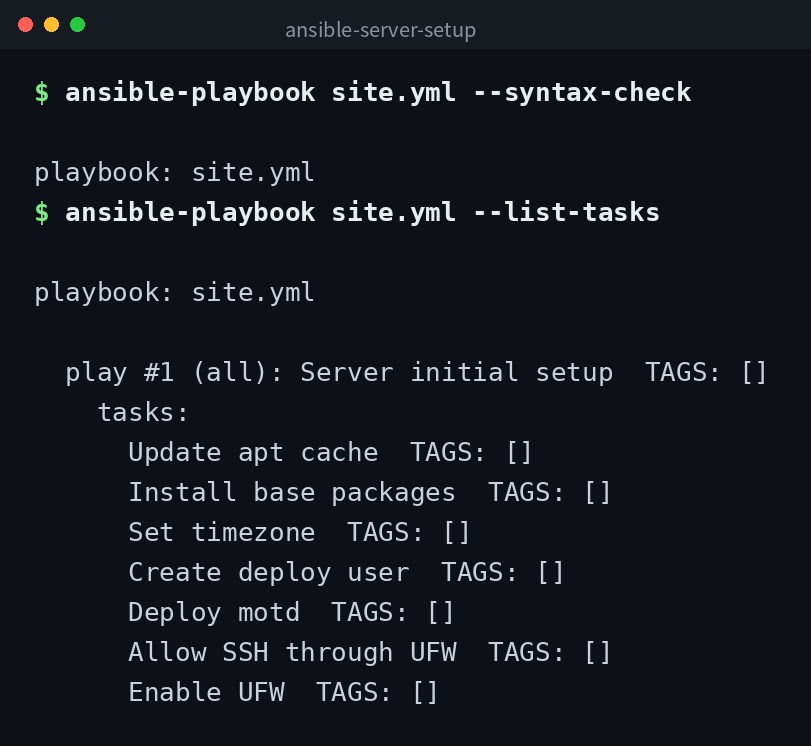

[English](../README.md) | [日本語](../ja/README.md) | 한국어


# ansible-server-setup

Ansible로 서버 초기 설정을 자동화하는 플레이북입니다. 패키지 설치, 타임존 설정, 배포 사용자 생성, UFW 방화벽 설정을 수행합니다.

## 데모



## 전제 조건

- Ansible 2.14 이상
- 대상 서버는 Ubuntu / Debian 계열
- `community.general` 컬렉션이 설치되어 있어야 합니다

```bash
ansible-galaxy collection install community.general
```

## 구성

```
ansible-server-setup/
├── ansible.cfg        # Ansible 설정
├── inventory.ini      # 인벤토리 (접속 대상 정의)
├── group_vars/
│   └── all.yml        # 전체 호스트 공통 변수
├── site.yml           # 메인 플레이북
└── templates/
    └── motd.j2        # 로그인 시 메시지 템플릿
```

## 사용법

### 1. 인벤토리 편집

`inventory.ini`의 `[servers]` 섹션에 대상 서버의 IP 주소 또는 호스트명을 기재하세요.

### 2. 드라이런 (확인)

실제 변경 없이 어떤 작업이 실행되는지 확인합니다.

```bash
ansible-playbook site.yml --check --diff
```

### 3. 본 실행

```bash
ansible-playbook site.yml
```

다른 인벤토리 파일을 사용하는 경우 `-i`로 지정할 수 있습니다.

```bash
ansible-playbook site.yml -i /path/to/inventory.ini
```

### 4. 로컬 동작 확인

`inventory.ini`의 `[local]`을 사용하면 로컬 머신에서 테스트할 수 있습니다.

```bash
ansible-playbook site.yml --limit local
```

## 변수 커스터마이즈

`group_vars/all.yml`에서 다음 변수를 변경할 수 있습니다.

| 변수 | 설명 | 기본값 |
|------|------|--------|
| `timezone` | 서버 타임존 | `Asia/Tokyo` |
| `deploy_user` | 생성할 배포용 사용자명 | `deploy` |
| `base_packages` | 설치할 패키지 목록 | vim, curl, git, htop, ufw, unattended-upgrades |

## 주의사항

- 이 플레이북은 초기 설정을 목적으로 합니다. SSH 설정 변경이나 포트 변경 등 접속이 끊길 수 있는 작업은 포함되어 있지 않습니다.
- UFW의 기본 정책은 deny입니다. SSH (22번 포트)는 허용 설정이 되어 있지만, 다른 포트가 필요한 경우 사전에 태스크를 추가하세요.
- 프로덕션 환경에 적용하기 전에 반드시 `--check` 옵션으로 내용을 확인하세요.

## 클론

```bash
git clone https://github.com/mivork/ansible-server-setup.git
```
